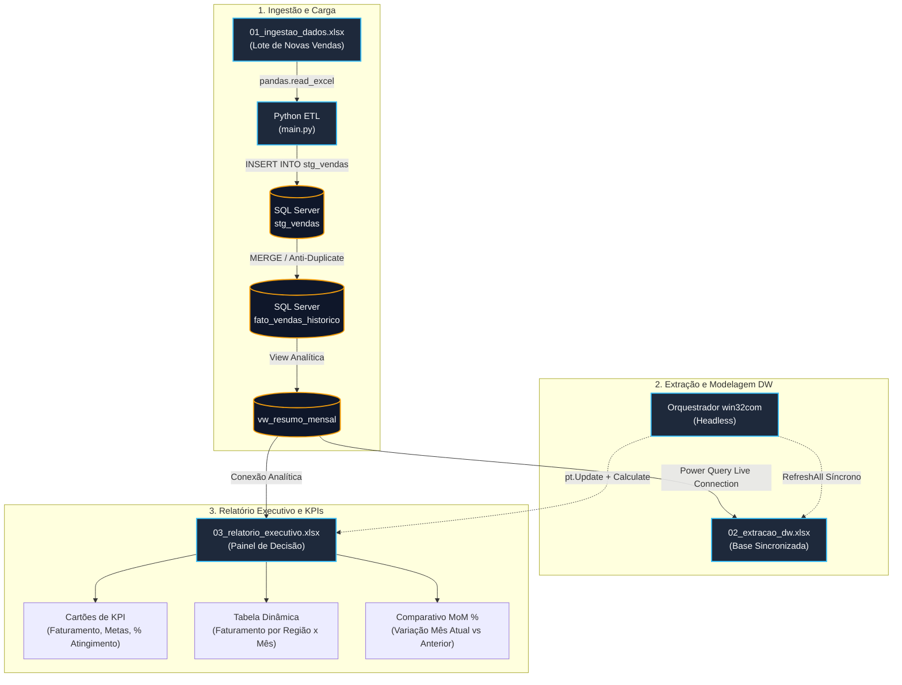

# ⚙️ Pipeline de Automação de Relatórios: Python + SQL Server + Excel Headless

[Python](https://www.google.com/search?q=https%3A%2F%2Fwww.python.org%2F)
[SQL Server](https://www.google.com/search?q=https%3A%2F%2Fwww.microsoft.com%2Fsql-server)
[Microsoft Excel](https://www.google.com/search?q=https%3A%2F%2Fwww.microsoft.com%2Fexcel)
[Windows](https://www.google.com/search?q=https%3A%2F%2Fwww.microsoft.com%2Fwindows)
[License: MIT](https://www.google.com/search?q=LICENSE)

Pipeline de automação de ponta a ponta (RPA e Engenharia de Dados) desenvolvido em **Python**, orquestrando cargas atômicas no **SQL Server** e a atualização síncrona de pastas de trabalho analíticas no **Microsoft Excel** sem renderização de interface gráfica (*Headless Mode* via API COM).

---

## 📌 Visão Geral e Contexto de Negócio

Em ambientes corporativos de Controladoria, FP&A e Business Intelligence, a atualização diária ou mensal de relatórios em Excel frequentemente enfrenta três grandes gargalos:

1. **Sobrecarga de Hardware:** Abrir múltiplos arquivos pesados com conexões ODBC, fórmulas complexas e tabelas dinâmicas consome gigabytes de memória RAM e trava a máquina do analista.
2. **Risco de Inconsistência:** O usuário precisa lembrar de atualizar conexões na ordem exata (banco primeiro, tabelas analíticas depois, relatórios de KPI por último), além de aguardar as consultas assíncronas terminarem antes de salvar.
3. **Perda de Produtividade:** Horas de trabalho manual desperdiçadas em tarefas repetitivas de "abrir, clicar em atualizar tudo, esperar e salvar".

### A Solução
Este projeto substitui completamente a intervenção manual por um pipeline em **Python** que:
- Executa a ingestão atômica de novos dados brutos para tabelas de *staging* e consolidação no *Data Warehouse* relacional;
- Atualiza em segundo plano as conexões Power Query das planilhas analíticas;
- Atualiza caches de Tabelas Dinâmicas (*Pivot Tables*) e recalcula fórmulas estatísticas e financeiras (`SUMIFS`, variações *Month-over-Month*);
- Encerra de forma limpa todas as instâncias de memória do Excel, gerando logs rastreáveis no terminal.

---

## 🏗️ Arquitetura da Solução

O fluxo opera em uma esteira sequencial e síncrona dividida em 3 estágios:



---

## 🗂️ Estrutura do Repositório

```text
Automacao_Python/
├── .env.example              # Modelo seguro de variáveis de ambiente
├── .gitignore                # Regras de exclusão (ignora .env, venv e arquivos temporários ~$*)
├── LICENSE                   # Licença MIT
├── README.md                 # Documentação técnica do projeto
├── requirements.txt          # Dependências com versões especificadas
├── main.py                   # Script principal orquestrador do pipeline
├── data/
│   ├── 01_ingestao_dados.xlsx      # Entrada: novos dados transacionais da operação
│   ├── 02_extracao_dw.xlsx        # Extração: conexão viva com a view do SQL Server
│   └── 03_relatorio_executivo.xlsx # Dashboard: KPIs, Tabela Dinâmica e fórmulas MoM
├── sql/
│   └── 01_create_tables.sql       # Script DDL com banco, tabelas (stg/fato) e view
└── src/
    ├── __init__.py
    ├── config.py                  # Módulo centralizado de configurações
    ├── db_loader.py               # Operações transacionais e conexão pyodbc
    └── excel_updater.py           # Engine de manipulação COM do Excel
```

---

## ⚙️ Boas Práticas de Engenharia Aplicadas

### 1. Automação Headless Segura e Liberação de Recursos
Automações com Office via COM frequentemente falham ao deixar instâncias órfãs de `EXCEL.EXE` consumindo memória em background. Este projeto implementa:
- Inicialização com `Visible = False`, `DisplayAlerts = False` e `ScreenUpdating = False`;
- Encapsulamento completo em blocos `try...finally`;
- Chamada explícita de `workbook.Close(SaveChanges=False)` e `excel_app.Quit()`, com desalocação de ponteiros (`del workbook`, `del excel_app`) para garantir encerramento pelo *Garbage Collector*.

### 2. Atualização Síncrona Forçada (*Anti-Race Condition*)
Por padrão, o Excel atualiza conexões de dados em segundo plano de forma assíncrona, o que faria o script salvar e fechar a planilha antes que as consultas terminassem. O código contorna isso programaticamente:
```python
for conn in workbook.Connections:
    if conn.Type in (1, 2):  # OLEDB / ODBC
        conn.OLEDBConnection.BackgroundQuery = False

workbook.RefreshAll()
excel_app.CalculateUntilAsyncQueriesDone()
```

### 3. Idempotência e Tratamento de Duplicidade
A carga no SQL Server utiliza uma tabela transitória de *Staging* (`stg_vendas`) antes de inserir na tabela definitiva (`fato_vendas_historico`), garantindo que apenas registros não existentes sejam persistidos:
```sql
INSERT INTO dbo.fato_vendas_historico (id_venda, data_venda, filial, produto, quantidade, valor_unitario, valor_total)
SELECT s.id_venda, s.data_venda, s.filial, s.produto, s.quantidade, s.valor_unitario, s.valor_total
FROM dbo.stg_vendas s
WHERE NOT EXISTS (
    SELECT 1 FROM dbo.fato_vendas_historico f 
    WHERE f.id_venda = s.id_venda AND f.data_venda = s.data_venda
);
```

### 4. Segurança de Credenciais
Credenciais e nomes de instâncias são estritamente isolados em arquivo `.env` via `python-dotenv`. O `.env` está catalogado no `.gitignore` para prevenir qualquer vazamento acidental em commits públicos.

### 5. Logging Estruturado no Terminal
Substituição de saídas de texto genéricas por logs padronizados (`logging`) com formato ISO/tempo, níveis de severidade (`INFO`, `WARNING`, `CRITICAL`) e contadores de tempo decorrido por etapa.

---

## 🚀 Como Executar o Projeto

### Pré-requisitos
- Sistema Operacional **Windows 10 ou 11**
- **Python 3.10 ou superior** instalado e adicionado ao PATH
- **Microsoft Excel** instalado localmente
- **SQL Server** (Developer, Express ou Standard)
- Driver ODBC da Microsoft (*ODBC Driver 17 for SQL Server*)

### Passo 1: Clonar o Repositório e Criar o Ambiente Virtual
Abra o PowerShell na pasta de sua preferência:
```powershell
git clone https://github.com/SEU_USUARIO/Automacao_Python.git
cd Automacao_Python

# Criar e ativar o ambiente virtual
python -m venv venv
.\venv\Scripts\Activate.ps1
```

### Passo 2: Instalar as Dependências
```powershell
pip install -r requirements.txt
```

### Passo 3: Configurar o Banco de Dados
Abra o SQL Server Management Studio (SSMS) ou a extensão **SQL Server (mssql)** no VS Code, conecte-se à sua instância e execute o script:
```powershell
# Executar o arquivo sql/01_create_tables.sql
```

### Passo 4: Configurar as Variáveis de Ambiente
Copie o arquivo de exemplo para criar seu `.env` local:
```powershell
Copy-Item .env.example .env
```
Edite o arquivo `.env` com a sua instância do SQL Server:
```env
DB_SERVER=localhost
DB_DATABASE=db_automacao
DB_TRUSTED_CONNECTION=yes
```

### Passo 5: Executar o Pipeline
Certifique-se de que os arquivos Excel estão fechados e execute:
```powershell
python main.py
```

---

## 📊 Exemplo de Saída no Terminal

```text
11:25:01 [INFO] INICIANDO PIPELINE DE AUTOMAÇÃO DE RELATÓRIOS
11:25:01 [INFO] === [ETAPA 1/3] Carga de Dados no SQL Server ===
11:25:01 [INFO] Lendo registros de 01_ingestao_dados.xlsx...
11:25:02 [INFO] [OK] 10 registros processados e consolidados no banco.
11:25:02 [INFO] === [ETAPA 2/3] Atualizando Planilha 02 (Extração do Banco) ===
11:25:06 [INFO] [OK] 02_extracao_dw.xlsx atualizado e recalculado em 3.82s.
11:25:06 [INFO] === [ETAPA 3/3] Atualizando Planilha 03 (Relatório Executivo e Fórmulas) ===
11:25:11 [INFO] [OK] 03_relatorio_executivo.xlsx atualizado e recalculado em 4.95s.
11:25:11 [INFO] PIPELINE CONCLUÍDO COM SUCESSO! Tempo total: 9.98s
```

---

## 🛠️ Tecnologias Utilizadas

| Tecnologia | Finalidade no Projeto |
| :--- | :--- |
| **Python** | Linguagem principal de orquestração do pipeline |
| **pywin32 (win32com)** | Automação COM de baixo nível para controle headless do Excel |
| **pandas** | Leitura rápida, validação e manipulação de lotes tabulares |
| **pyodbc** | Driver de alta performance para conexão com o SQL Server |
| **python-dotenv** | Gerenciamento de credenciais e parâmetros via `.env` |
| **SQL Server** | Armazenamento relacional, controle transacional e views analíticas |
| **Microsoft Excel & Power Query** | Modelagem analítica, tabelas dinâmicas e dashboards executivos |

---

## 📄 Licença

Este projeto está sob a licença [MIT](https://www.google.com/search?q=LICENSE) - consulte o arquivo para detalhes.
