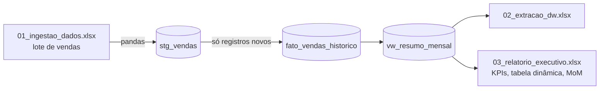

# Automação de relatórios: Python + SQL Server + Excel em segundo plano

Pipeline que carrega um lote de vendas no SQL Server e, em seguida, atualiza as planilhas de relatório (conexões, tabelas dinâmicas e fórmulas) **sem abrir a interface do Excel**.

## Por que este projeto existe

No meu último cargo, em Planejamento Comercial, o relatório de performance dependia de planilhas pesadas, cheias de consultas, fórmulas e tabelas dinâmicas. Atualizar tudo na mão tomava mais de uma manhã e travava a máquina. Com Python atualizando uma consulta por vez em segundo plano, a rotina passou a levar cerca de 30 minutos.

Este repositório reproduz essa abordagem com dados fictícios, para que qualquer pessoa possa ver e executar.

## Como funciona



1. **Carga:** lê a planilha de entrada, limpa a tabela de staging e insere o lote.
2. **Consolidação:** copia para a tabela histórica apenas o que ainda não existe, então rodar duas vezes não duplica dados.
3. **Atualização do Excel:** abre cada planilha em segundo plano, desliga a atualização assíncrona das conexões, roda `RefreshAll`, espera as consultas terminarem, atualiza as tabelas dinâmicas, recalcula e salva.
4. **Encerramento seguro:** fecha a planilha e o Excel mesmo se algo falhar, para não sobrar processo `EXCEL.EXE` aberto.

## Pontos de atenção que o código resolve

- **Salvar antes da consulta terminar:** por padrão o Excel atualiza conexões em segundo plano. O script força a atualização síncrona antes de salvar.
- **Duplicidade:** a carga passa pela staging e só entra na tabela histórica o que não existe (`NOT EXISTS` por id e data).
- **Credenciais fora do código:** servidor e banco ficam no `.env`, que está no `.gitignore`.
- **Rastreabilidade:** cada etapa registra log com horário e tempo de execução.

## Estrutura

```text
Automacao_Python/
├── main.py                      # pipeline completo (carga + atualização do Excel)
├── sql/01_create_tables.sql     # banco, tabelas staging e histórica, view mensal
├── src/gerar_planilhas_teste.py # gera as planilhas de exemplo
├── data/                        # planilhas de entrada e de relatório
├── requirements.txt
└── .env.example
```

## Como executar

Pré-requisitos: Windows, Python 3.10+, Microsoft Excel, SQL Server e ODBC Driver 17 for SQL Server.

```powershell
git clone https://github.com/lenoguedes/Automacao_Python.git
cd Automacao_Python
python -m venv venv
.\venv\Scripts\Activate.ps1
pip install -r requirements.txt
Copy-Item .env.example .env   # ajuste o nome da sua instância
```

Execute `sql/01_create_tables.sql` no SQL Server e depois:

```powershell
python main.py
```

Saída esperada:

```text
[INFO] === [ETAPA 1/3] Carga de Dados no SQL Server ===
[INFO] [OK] 10 registros processados e consolidados no banco.
[INFO] === [ETAPA 2/3] Atualizando Planilha 02 (Extração do Banco) ===
[INFO] === [ETAPA 3/3] Atualizando Planilha 03 (Relatório Executivo e Fórmulas) ===
[INFO] PIPELINE CONCLUÍDO COM SUCESSO!
```

## Próximos passos

- Separar conexão, carga e atualização do Excel em módulos.
- Trocar o insert linha a linha por carga em lote (`fast_executemany`).
- Agendar a execução pelo Agendador de Tarefas do Windows.

## Tecnologias

Python (pandas, pyodbc, pywin32, python-dotenv), SQL Server, Excel e Power Query.

Licença MIT.
